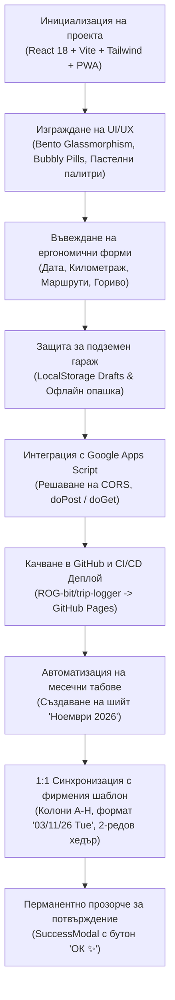

# Подробен Доклад за Разработката на „Taigo Log“ ✨
**Дигитален Пътен Лист за Volkswagen Taigo (СВ 8529 XH) – Мая Атанасова**

---

## 1. Резюме на Проекта (Executive Summary)

Проектът **Taigo Log** представлява мобилно-ориентирано Progressive Web Application (PWA), създадено специално за нуждите на **Мая Атанасова**, управляваща служебен/личен автомобил **Volkswagen Taigo** с регистрационен номер **`СВ 8529 XH`**. 

Целта на приложението е да замени тромавото ръчно попълване на електронни таблици с интуитивен, свръхелегантен ("chic & bubbly") и бърз интерфейс, пригоден за използване с една ръка директно в колата, като същевременно гарантира:
1. **100% съвместимост** с официалния фирмен шаблон за отчет на пътуванията (колони A до H).
2. **Директен запис в Google Sheets** в реално време чрез Google Apps Script Web App.
3. **Безотказна работа в условия на нулев обхват (подземни гаражи)**.
4. **Лесно инсталиране на iPhone и Android** като нативно приложение без браузърни рамки.

---

## 2. Архитектурен и Технологичен Стек

| Компонент | Използвана технология | Предназначение и предимства |
| :--- | :--- | :--- |
| **Фронтенд рамка** | React 18 & TypeScript | Строга типизация, стабилност при изпълнение, компонентна архитектура |
| **Сборка & Bundler** | Vite 5 | Мигновен Hot Module Replacement (HMR), оптимизиран production билд |
| **Стилизиране** | Tailwind CSS v3 | Bubbly & Bento естетика, Glassmorphism, персонализирани пастелни палитри |
| **Иконография** | Lucide React | Изчистени векторни икони в пастелни капсули |
| **Офлайн Кеш & PWA** | Web App Manifest + Service Worker | Работа без интернет, кеширане на асети, възможност за инсталиране |
| **Бекенд & База Данни** | Google Apps Script + Google Sheets | Безплатен, сигурен и безсървърен бекенд, директно обвързан с екселската таблица |
| **CI/CD & Хостинг** | GitHub Actions + GitHub Pages | Автоматизиран билд и публикуване в глобален CDN при всяка промяна |

---

## 3. Хронология на Изпълнението и Развитието



---

## 4. Визуален и Интерактивен Дизайн (Chic & Tactile)

Приложението е проектирано с фокус върху естетиката и удобството за водача:
- **Цветова палитра**: Топъл керамичен градиент (`#FDFBF7` ➔ `#FDF5F2` ➔ `#F9ECE8`), предотвратяващ умората на очите и непозволяващ случайно маркиране на текст при бързо докосване (`user-select: none`).
- **Bento Glassmorphism**: Полупрозрачни стъклени карти (`bg-white/80 backdrop-blur-md`), заоблени ъгли (`rounded-3xl`) и нежни розови сенки (`shadow-[0_10px_30px_rgba(235,160,170,0.14)]`).
- **Пастелни капсули за иконите**:
  - 🚗 Розово/корал за идентификация на автомобила.
  - 📟 Мек кехлибар за километража на таблото.
  - 🟣 Пастелен люляк за маршрутите.
  - ⛽ Светъл корал за зареденото гориво.
  - 👤 Изумрудено ментово за личните километри.
- **Основен бутон за действие**: Сочен ягодово-розов градиент (`bg-gradient-to-r from-rose-400 via-pink-400 to-rose-400`) с лек пружиниращ ефект при натискане (`touch-bouncy active:scale-95`).

---

## 5. Ергономични Модули на Формуляра (Thumb-First)

### 5.1. Заглавна Карта (Vehicle Header)
- Балонче **`✨ My Taigo`** с въртяща се искра.
- Заглавие **Volkswagen Taigo** и реалистична българска регистрационна табела **`СВ 8529 XH`**.
- Подзаглавие **`Водач: Мая Атанасова 💕`**.
- Индикатор за статус на връзката (зелена пулсираща точка при наличие на мрежа или розов етикет *Офлайн* в подземен гараж).
- Бутони за бърз достъп до **История на пътуванията** (🕒) и **Настройки** (⚙️).

### 5.2. Избор на Дата (Date Picker Pod)
- По подразбиране зарежда днешната дата.
- Бързи бутони с едно докосване: **„Днес“** и **„Вчера“**.
- Възможност за избор на произволна дата през вградения календар.

### 5.3. Двоен Модул за Километраж (Odometer Dual Pod)
- **Начален км**: Автоматично извлечен от предходния запис в Google Таблицата или локалния кеш. Защитен с катинарче против неволна промяна, с опция за отключване при нужда от корекция.
- **Краен км \***: Висококонтрастно поле с розова рамка, голям шрифт и цифрова клавиатура (`inputMode="numeric"`).
- **Динамичен брояч на пробега**: В реално време изчислява разликата ($Краен - Начален$). При положителен пробег светва в розов градиент с индикация: `Днешен пробег: +XX км`. При грешка (ако крайното число е по-малко от началното) предупреждава веднага.

### 5.4. Бърз Избор на Маршрут (Route Selection)
- Интерактивни балончета с най-честите дестинации:
  - `София`
  - `София - лични`
  - `София-Благоевград-София`
  - `София-Плевен-София`
- Текстово поле под тях за свободно въвеждане на всяка друга дестинация.

### 5.5. Вторичен Ред (Secondary Row)
- **Лични километри**: По подразбиране 0.
- **Заредено гориво (л)**: Незадължително десетично поле с икона на бензиноколонка.

---

## 6. Защита за Подземен Гараж (Underground Garage Offline Protection)

Чест проблем при попълване на пътен лист е липсата на покритие в подземни паркинги. В приложението е внедрен многостепенен защитен механизъм:
1. **Автоматично запазване на чернова**: Всяко въведено число се запазва на момента в `localStorage`. Дори екранът да угасне или приложението да се затвори, данните не се губят.
2. **Офлайн опашка за изпращане**: При липса на интернет и натискане на бутона, формулярът **НЕ се изчиства**. Записът се поставя в локалната опашка `taigo_pending_queue`.
3. **Нежен банер за спокойствие**:
   > *„Няма връзка (подземен гараж?). Данните са запазени, опитай отново горе на светло! ✨“*
4. **Автоматична синхронизация**: Щом телефонът улови мобилна мрежа или Wi-Fi, приложението автоматично предлага или изпраща чакащите записи към Google Sheets.

---

## 7. Google Apps Script и 100% Съвместимост с Фирмения Шаблон

### 7.1. Решаване на CORS проблема
Стандартните `application/json` заявки към Google Apps Script се провалят заради preflight `OPTIONS` проверки. Проблемът е решен чрез изпращане на заявката като `text/plain;charset=utf-8`:
```typescript
await fetch(API_URL, {
  method: "POST",
  headers: { "Content-Type": "text/plain;charset=utf-8" },
  body: JSON.stringify(payload),
});
```

### 7.2. Автоматично създаване на Месечни Табове
Скриптът в [`google-apps-script/Code.gs`](file:///google-apps-script/Code.gs) прочита датата на пътуването и проверява за таб със съответния месец (напр. **„Ноември 2026“**). Ако такъв липсва, той се създава най-отпред с оригиналната двуредова заглавна структура.

### 7.3. Точно подреждане на колоните (A до H)
В отговор на предоставения оригинален фирмен образец, структурата на запис беше приведена в съответствие:

| Колона | Заглавие | Записвано съдържание | Формат |
| :---: | :--- | :--- | :--- |
| **A** | **Име на водача** | `Мая Атанасова` | Текст, подравнен вляво |
| **B** | **Дата** | `03/11/26 Tue` | `DD/MM/YY Ddd`, центрирано |
| **C** | **Начален километраж** | `47,754` | Число с разделител за хиляди (`#,##0`) |
| **D** | **Краен километраж** | `47,758` | Число с разделител за хиляди (`#,##0`) |
| **E** | **Лични** | `4` или празно при 0 | Число / празна клетка |
| **F** | **Общо за деня** | `4` (изчислен пробег) | Число с разделител за хиляди |
| **G** | **Заредено гориво (л)** | литри или празно | Десетично число / празна клетка |
| **H** | **Маршрут** | `София` | Текст, подравнен вляво |

*Резултат:* Потребителят може директно да маркира редовете от Google Таблицата и да ги копира с `Ctrl+C / Ctrl+V` във финалния фирмен файл без никакви корекции.

---

## 8. Перманентен Прозорец за Потвърждение (SuccessModal)

За максимално спокойствие на потребителя, временният 3-секунден банер бе заменен от самостоятелен модален диалог:
- Остава на екрана **перманентно** до натискане на бутона.
- Показва красива анимация с чекмарк и златни искри.
- Дава подробна справка: дата, маршрут, начален ➔ краен километраж, изминати километри, заредено гориво.
- Съдържа сочен бутон **„ОК ✨“** за потвърждение и изчистване на формата.

---

## 9. Публикуване и PWA Инсталация

### 9.1. GitHub Репозиторий и CI/CD
- **Хранилище**: `https://github.com/ROG-bit/trip-logger` (клон `main`).
- **Автоматизация**: Създаден `.github/workflows/deploy.yml`, който при всеки `push` компилира приложението и го публикува в GitHub Pages.
- **Жив адрес**: [https://rog-bit.github.io/trip-logger/](https://rog-bit.github.io/trip-logger/)

### 9.2. Инсталиране на Началния Екран
Благодарение на конфигурираните `manifest.json`, икони (SVG и PNG 192/512) и `viewport-fit=cover`, приложението се инсталира като самостоятелна мобилна апликация:
- **iPhone (Safari)**: Бутон *Сподели (Share)* ➔ *„Към началния екран“ (Add to Home Screen)*.
- **Android (Chrome)**: Меню ➔ *„Инсталиране на приложението“ (Install App)*.
- Стартира без адресна лента на цял екран с полупрозрачен статус бар на iOS (`black-translucent`).

---

## 10. Обобщение на Създадените Файлове

- [`src/App.tsx`](file:///src/App.tsx) – Главен контролер, управление на състоянията, офлайн кеш и диалози.
- [`src/components/Header.tsx`](file:///src/components/Header.tsx) – Заглавна плаваща карта с табелата `СВ 8529 XH` и водача.
- [`src/components/DatePickerPod.tsx`](file:///src/components/DatePickerPod.tsx) – Модул за избор на дата (Днес/Вчера/Календар).
- [`src/components/OdometerPod.tsx`](file:///src/components/OdometerPod.tsx) – Двоен модул за таблото с динамичен брояч.
- [`src/components/RouteSelector.tsx`](file:///src/components/RouteSelector.tsx) – Балончета за бързи маршрути и ръчно поле.
- [`src/components/SecondaryRow.tsx`](file:///src/components/SecondaryRow.tsx) – Полета за лични километри и гориво.
- [`src/components/SuccessModal.tsx`](file:///src/components/SuccessModal.tsx) – Перманентно прозорче за потвърждение с бутон „ОК ✨“.
- [`src/components/OfflineBanner.tsx`](file:///src/components/OfflineBanner.tsx) – Известие и опашка за подземен гараж.
- [`src/components/HistoryModal.tsx`](file:///src/components/HistoryModal.tsx) – История на предишните пътувания.
- [`src/components/SettingsModal.tsx`](file:///src/components/SettingsModal.tsx) – Настройки на URL и възможност за копиране на скрипта.
- [`src/services/api.ts`](file:///src/services/api.ts) – Слой за комуникация с Google Apps Script и офлайн синхронизация.
- [`google-apps-script/Code.gs`](file:///google-apps-script/Code.gs) – Бекенд скрипт за Google Sheets с месечни табове и колони A-H.
- [`.github/workflows/deploy.yml`](file:///.github/workflows/deploy.yml) – GitHub Actions конвейер за деплой.
