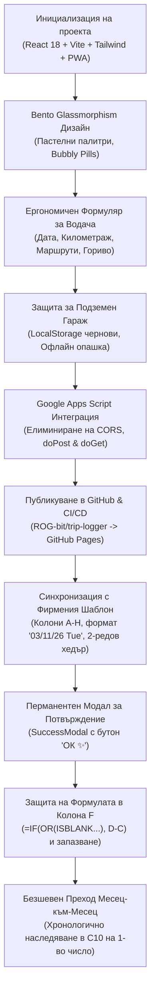

# Подробен Доклад за Разработката на „Taigo Log“ ✨
**Дигитален Пътен Лист за Volkswagen Taigo (СВ 8529 XH) – Мая Атанасова**

*Последна актуализация: Ноември 2026 г.*

---

## 1. Резюме на Проекта (Executive Summary)

Проектът **Taigo Log** представлява мобилно-ориентирано Progressive Web Application (PWA), създадено специално за нуждите на **Мая Атанасова**, управляваща автомобил **Volkswagen Taigo** с регистрационен номер **`СВ 8529 XH`**. 

Приложението замества ръчното попълване на екселски таблици с интуитивен, свръхелегантен ("chic & bubbly") и бърз интерфейс, оптимизиран за управление с една ръка директно в автомобила. То осигурява:
1. **100% прецизно съответствие** с официалния фирмен шаблон за пътен лист (колони A до H).
2. **Динамична защита на формулите** в Google Sheets (колона F никога не се презаписва със статично число).
3. **Безшевен месечен преход** от 31-во към 1-во число с автоматично пренасяне на километража.
4. **Директна двупосочна интеграция** с Google Sheets чрез Google Apps Script Web App.
5. **Безотказна защита в подземни гаражи (офлайн режим)** с локално съхранение и автоматична синхронизация.
6. **Перманентно потвърждение на записите** с интерактивно прозорче и бутон „ОК ✨“.
7. **PWA инсталация** на начален екран на iPhone и Android като нативно приложение.

---

## 2. Архитектурен и Технологичен Стек

| Компонент | Използвана технология | Предназначение и предимства |
| :--- | :--- | :--- |
| **Фронтенд рамка** | React 18 & TypeScript | Строга типизация, стабилност при изпълнение, компонентна архитектура |
| **Сборка & Bundler** | Vite 5 | Мигновен Hot Module Replacement (HMR), оптимизиран production билд |
| **Стилизиране** | Tailwind CSS v3 | Bubbly & Bento естетика, Glassmorphism, пастелни палитри |
| **Иконография** | Lucide React | Изчистени векторни икони в заоблени пастелни капсули |
| **Офлайн Кеш & PWA** | Web App Manifest + Service Worker | Работа без интернет, кеширане на асети, инсталиране на начален екран |
| **Бекенд & База Данни** | Google Apps Script + Google Sheets | Безплатен, сигурен и безсървърен бекенд, директно обвързан с екселската таблица |
| **CI/CD & Хостинг** | GitHub Actions + GitHub Pages | Автоматизиран билд и публикуване в глобален CDN при всяка промяна |

---

## 3. Хронология на Изпълнението и Развитието

---

## 4. Визуален и Интерактивен Дизайн (Chic & Tactile)

- **Цветова палитра**: Топъл керамичен градиент (`#FDFBF7` ➔ `#FDF5F2` ➔ `#F9ECE8`), предотвратяващ умората на очите и маркиране на текст при бързо докосване (`user-select: none`).
- **Bento Glassmorphism**: Полупрозрачни стъклени карти (`bg-white/80 backdrop-blur-md`), заоблени ъгли (`rounded-3xl`) и нежни розови сенки (`shadow-[0_10px_30px_rgba(235,160,170,0.14)]`).
- **Пастелни капсули за иконите**:
  - 🚗 Розово/корал за автомобил и табло.
  - 📟 Мек кехлибар за километража.
  - 🟣 Пастелен люляк за маршрутите.
  - ⛽ Светъл корал за зареденото гориво.
  - 👤 Изумрудено ментово за личните километри.
- **Основен бутон за действие**: Сочен ягодово-розов градиент (`bg-gradient-to-r from-rose-400 via-pink-400 to-rose-400`) с лек пружиниращ ефект при натискане (`touch-bouncy active:scale-95`).

---

## 5. Ергономични Модули на Формуляра (Thumb-First)

### 5.1. Заглавна Карта (Vehicle Header)
- Балонче **`✨ My Taigo`** с въртяща се искра.
- Заглавие **Volkswagen Taigo** и реалистична българска регистрационна табела **`СВ 8529 XH`**.
- Подзаглавие **`Водач: Мая Атанасова 💕`**.
- Индикатор за статус на връзката (зелена точка при наличност на интернет или розов етикет *Офлайн* в подземен гараж).
- Бутони за бърз достъп до **История на пътуванията** (🕒) и **Настройки** (⚙️).

### 5.2. Избор на Дата (Date Picker Pod)
- По подразбиране зарежда днешната дата.
- Бързи бутони с едно докосване: **„Днес“** и **„Вчера“**.
- Възможност за избор на произволна дата през вградения календар.

### 5.3. Двоен Модул за Километраж (Odometer Dual Pod)
- **Начален км**: Автоматично извлечен от Google Sheets или предходен запис. Защитен с катинарче против неволна промяна, с опция за ръчна корекция.
- **Краен км \***: Висококонтрастно поле с розова рамка, голям шрифт и цифрова клавиатура (`inputMode="numeric"`).
- **Динамичен брояч на пробега**: В реално време изчислява разликата ($Краен - Начален$). При положителен пробег светва в розов градиент с индикация: `Днешен пробег: +XX км`. Предупреждава незабавно при опит за въвеждане на по-малко число.

### 5.4. Бърз Избор на Маршрут (Route Selection)
- Интерактивни балончета с най-честите дестинации:
  - `София`
  - `София - лични`
  - `София-Благоевград-София`
  - `София-Плевен-София`
- Текстово поле под тях за свободно въвеждане на всяка друга дестинация.

### 5.5. Вторичен Ред (Secondary Row)
- **Лични километри**: По подразбиране 0 (не се изпраща, ако няма частно каране).
- **Заредено гориво (л)**: Незадължително десетично поле с икона на бензиноколонка.

---

## 6. Защита за Подземен Гараж (Underground Garage Offline Protection)

Чест проблем при попълване на пътен лист е липсата на мобилен обхват в подземни паркинги. Внедреният защитен механизъм включва:
1. **Автоматично запазване на чернова**: Всяко въведено число се съхранява в `localStorage`. Дори екранът да угасне, данните са защитени.
2. **Офлайн опашка за изпращане**: При липса на връзка при натискане на бутона, формулярът **НЕ се изчиства**. Записът се поставя в локалната опашка `taigo_pending_queue`.
3. **Нежен банер за спокойствие**:
   > *„Няма връзка (подземен гараж?). Данните са запазени, опитай отново горе на светло! ✨“*
4. **Фонова синхронизация**: Щом телефонът улови интернет сигнал, приложението предлага или автоматично изпраща чакащите записи към Google Sheets.

---

## 7. Google Apps Script: 100% Фирмен Интегритет и Автоматизация

Скриптът в [`google-apps-script/Code.gs`](file:///google-apps-script/Code.gs) управлява логиката в Google Sheets:

### 7.1. Точно съответствие на колоните (от A до H)
Структурата на запис е синхронизирана 1:1 с фирмения образец:

| Колона | Име във фирмения документ | Записвано съдържание | Форматиране |
| :---: | :--- | :--- | :--- |
| **A** | **Име на водача** | `Мая Атанасова` | Текст, подравнен вляво |
| **B** | **Дата** | `03/11/26 Tue` | `DD/MM/YY Ddd`, центрирано |
| **C** | **Начален километраж** | напр. `47,754` | Число, подравнено вдясно, с разделител (`#,##0`) |
| **D** | **Краен километраж** | напр. `47,758` | Число, подравнено вдясно, с разделител (`#,##0`) |
| **E** | **Лични** | напр. `4` или **празно** (при 0) | Число, подравнено вдясно |
| **F** | **Общо за деня** | **НАТИВНА ФОРМУЛА** (не число!) | `=IF(OR(ISBLANK(C{r}), ISBLANK(D{r})), "", D{r}-C{r})` |
| **G** | **Заредено гориво (л)** | литри гориво или **празно** | Число, подравнено вдясно |
| **H** | **Маршрут** | напр. `София` | Текст, подравнен вляво |

### 7.2. Защита на динамичната формула в Колона F
- При изпращане на данни от мобилното приложение (`doPost`), **колона F никога не се презаписва със статична стойност**.
- На целевия ред (`targetRow = 9 + dayOfMonth`) скриптът поставя или гарантира нативната формула `=IF(OR(ISBLANK(C{row}), ISBLANK(D{row})), "", D{row}-C{row})`.
- При функцията за изчистване на месечен шаблон (`clearMonthUserInputs`), се чистят само полетата за въвеждане (`C10:E40` и `G10:H40`). Формулите в `F10:F40` **остават напълно недокоснати**.

### 7.3. Безшевен преход от 31-во към 1-во число (Rollover)
За да се избегне проблемът с нулеви стойности в началото на нов месец:
1. **Автоматично пренасяне при създаване на таб (`createNewMonthTab`)**:
   - При преминаване в нов месец (напр. декември 2026), скриптът хронологично намира предходния месец (ноември 2026).
   - Сканира колона D на предходния месец (редове 40 нагоре към 10) и открива последния попълнен краен километраж.
   - Записва го като стартов начален километраж директно в клетка **`C10`** на новия месец.
2. **3-степенна логика при извличане в `doGet(e)`**:
   - **Степен 1**: Чете последния попълнен краен километраж в колона D на текущия месец.
   - **Степен 2**: Ако колона D е празна, прочита стартовата клетка `C10` на текущия месец.
   - **Степен 3**: Ако и `C10` е празно, сканира хронологично предходния месец за последния му краен км.
3. **Резултат за водача**: Още с отварянето на приложението на 1-во число, „Начален км“ вече е точно попълнен с километража от предната вечер!

### 7.4. Пакетни операции и бързодействие
Всички 31 реда за дните от месеца (редове 10 до 40) и формулите за колона F се генерират пакетно (`setValues` и `setFormulas`) в рамките на под 200ms, предотвратявайки таймаути на Google скрипта.

---

## 8. Перманентен Прозорец за Потвърждение (SuccessModal)

За да може потребителят спокойно да провери записа си:
- На мястото на временните съобщения е внедрен модален диалогов прозорец.
- **Остава на екрана перманентно**, докато Мая не натисне бутона **„ОК ✨“**.
- Показва анимация и подробна справка за пътуването: дата, маршрут, пробег (+XX км), крайно показание на таблото и заредено гориво.

---

## 9. Публикуване и PWA Инсталация

### 9.1. GitHub Репозиторий и CI/CD
- **Хранилище**: `https://github.com/ROG-bit/trip-logger` (клон `main`).
- **Автоматизация**: GitHub Actions конвейер в `.github/workflows/deploy.yml`.
- **Жив адрес**: [https://rog-bit.github.io/trip-logger/](https://rog-bit.github.io/trip-logger/)

### 9.2. Инсталиране на Началния Екран
- **iPhone (Safari)**: Бутон *Сподели (Share)* ➔ *„Към началния екран“ (Add to Home Screen)*.
- **Android (Chrome)**: Меню ➔ *„Инсталиране на приложението“ (Install App)*.
- Работи като нативна апликация на цял екран без адресни ленти (`standalone`, `black-translucent`).

---

## 10. Обобщение на Проектната Структура

- [`src/App.tsx`](file:///src/App.tsx) – Главен контролер, състояния на формата, офлайн опашка и модали.
- [`src/components/Header.tsx`](file:///src/components/Header.tsx) – Заглавна плаваща карта с табелата `СВ 8529 XH` и статуса.
- [`src/components/DatePickerPod.tsx`](file:///src/components/DatePickerPod.tsx) – Модул за дата (Днес / Вчера / Календар).
- [`src/components/OdometerPod.tsx`](file:///src/components/OdometerPod.tsx) – Двоен модул за таблото с динамичен калкулатор на пробега.
- [`src/components/RouteSelector.tsx`](file:///src/components/RouteSelector.tsx) – Бързи маршрутни балончета и свободно поле.
- [`src/components/SecondaryRow.tsx`](file:///src/components/SecondaryRow.tsx) – Лични километри и гориво в литри.
- [`src/components/SuccessModal.tsx`](file:///src/components/SuccessModal.tsx) – Перманентно прозорче за потвърждение с бутон „ОК ✨“.
- [`src/components/OfflineBanner.tsx`](file:///src/components/OfflineBanner.tsx) – Офлайн банер и синхронизация за подземен гараж.
- [`src/components/HistoryModal.tsx`](file:///src/components/HistoryModal.tsx) – История на предишните пътувания.
- [`src/components/SettingsModal.tsx`](file:///src/components/SettingsModal.tsx) – Конфигурация на Web App URL и копиране на кода.
- [`src/services/api.ts`](file:///src/services/api.ts) – Слой за комуникация с Google Apps Script и офлайн кеширане.
- [`google-apps-script/Code.gs`](file:///google-apps-script/Code.gs) – Бекенд скрипт с формула в колона F, месечни табове и плавен преход.
- [`.github/workflows/deploy.yml`](file:///.github/workflows/deploy.yml) – Автоматичен GitHub Actions конвейер за деплой.
